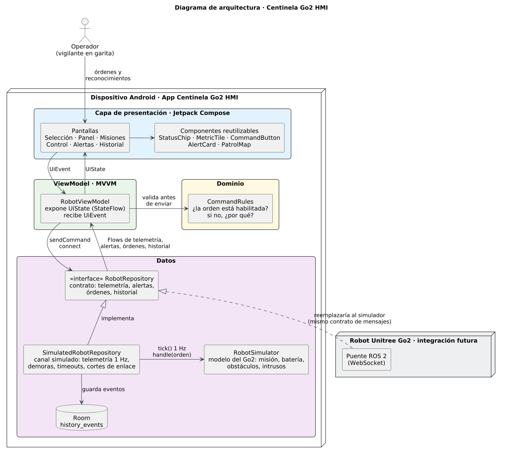
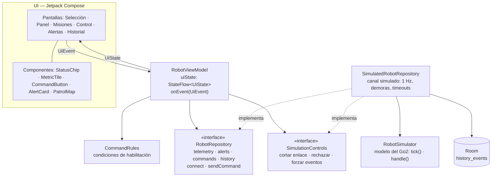

# Arquitectura

Kotlin + Jetpack Compose, MVVM con `ViewModel` y `StateFlow`. La UI observa estado y envía eventos;
nunca toca el Repository ni el simulador.

## Diagrama de arquitectura

Fuente editable en PlantUML: [`diagrama-arquitectura.puml`](diagrama-arquitectura.puml).

## Vista por capas

## Capas

| Capa | Paquete | Responsabilidad |
|---|---|---|
| Modelos | `model` | Datos inmutables: `Telemetry`, `Alert`, `CommandRecord`, `MissionPlan`, `HistoryEvent`. Sin Android. |
| Dominio | `domain` | `CommandRules`: decide si una orden está habilitada y, si no, por qué. Función pura. |
| Datos | `data` | `RobotRepository` (contrato), `SimulatedRobotRepository` (implementación), Room. |
| Presentación | `ui` | `RobotViewModel` combina los flujos en un único `UiState`; Compose lo dibuja. |

## Flujo de datos

- **Hacia la UI:** el Repository expone `StateFlow` (telemetría, alertas, órdenes, conexión) y un
  `Flow` de Room (historial). El ViewModel los combina con un reloj de 500 ms para calcular la
  antigüedad del dato (`dataAgeMs`, `stale`) y la habilitación de cada orden.
- **Desde la UI:** toda acción es un `UiEvent` (`SendCommand`, `SelectRobot`, `SimObstacle`…). El
  ViewModel revalida la habilitación antes de llamar a `repository.sendCommand(...)`.
- **Resultado de una orden:** no se devuelve; llega de forma asíncrona como cambio de estado del
  `CommandRecord` en `commands` (pendiente → confirmada / rechazada / sin respuesta).

## El Repository simulado

`SimulatedRobotRepository` reemplaza a la vez al robot y a la red:

- Cada segundo avanza `RobotSimulator.tick()` y, si el enlace está activo, publica un `Telemetry`
  nuevo y entrega los eventos del robot (alertas, cambios de misión).
- Con el enlace cortado **el robot sigue funcionando** pero la app deja de recibir datos. A los 3 s
  sin telemetría la conexión pasa a `LOST` y se genera una alerta local. Al volver el enlace llegan
  juntos el estado actual y lo ocurrido durante el corte.
- Una orden tarda 0,5–1,1 s en responder. Si el enlace está caído se esperan 5 s y queda **sin
  respuesta**. Si no, decide el robot (`RobotSimulator.handle`), que puede **rechazarla** según su
  estado real, o por el interruptor "Rechazar órdenes" del panel de simulación.
- Todo el estado mutable se toca desde un único hilo lógico (`limitedParallelism(1)`).

`RobotSimulator` es Kotlin puro (sin corrutinas ni Android), por eso se prueba con tests unitarios
(`RobotSimulatorTest`).

## Cómo se reemplazaría por un robot real

Se escribe otra clase que implemente `RobotRepository` (por ejemplo sobre WebSocket contra un puente
ROS 2 en el Go2) usando los mensajes de [`contrato-mensajes.md`](contrato-mensajes.md), y se cambia
una línea en `AppContainer`. `SimulationControls` y el panel de simulación desaparecen. ViewModel,
reglas y pantallas no cambian.

## Persistencia

Room, tabla `history_events`: conexiones, órdenes con su resultado, cambios de misión, alertas y
acciones del operador. Se eligió Room porque el historial es una lista consultable y filtrable que
crece con el uso; DataStore no está pensado para eso.
