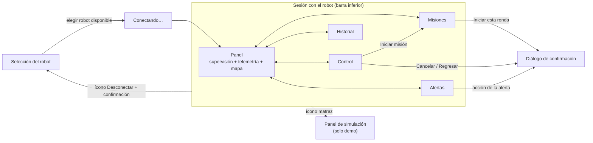

# Guía para el prototipo en Figma

**Prototipo:** [Centinela Go2 — HMI](https://www.figma.com/design/mfVVEeQQQo9xhWySi0EQqi/Centinela-Go2-%E2%80%94-HMI?node-id=0-1)

El Figma lo arma el grupo; esta guía describe lo que la app ya implementa para que el prototipo y el
APK coincidan. Las capturas de [`evidencias/`](evidencias/) sirven de referencia visual.

## Mapa de navegación

Elementos fijos en toda la sesión: nombre del robot y estado de conexión, franja de datos antiguos
(solo sin conexión), **franja de última orden** con su estado, y botón **Detener**.

## Pantallas (8 vistas pedidas por la consigna)

| Vista de la consigna | Dónde está |
|---|---|
| Selección del robot | Pantalla inicial: tres robots, uno en mantenimiento (deshabilitado) |
| Panel de supervisión | Pestaña Panel: alerta prioritaria, estado operativo, avance de misión, mapa |
| Telemetría | Pestaña Panel (misma vista, debajo del mapa): 10 tarjetas de datos |
| Misiones | Pestaña Misiones: misión actual + rondas disponibles |
| Control | Pestaña Control: todas las órdenes + lista de órdenes de la sesión |
| Alertas | Pestaña Alertas: activas y reconocidas |
| Historial | Pestaña Historial: lista filtrable por categoría |
| Desconexión | Estado transversal (franja roja, datos atenuados) + diálogo de desconexión voluntaria |

## Componentes reutilizables (y sus variantes)

| Componente | Variantes / estados |
|---|---|
| `StatusChip` | ok · advertencia · error · info · neutro; con o sin ícono |
| `MetricTile` | normal · advertencia · error · **dato antiguo** (atenuado) |
| `CommandButton` | habilitado (acento / advertencia / error / info) · **deshabilitado con motivo** |
| `CommandStatusChip` | pendiente · confirmada · rechazada · sin respuesta |
| `AlertCard` | info · advertencia · crítica · reconocida; con o sin "Requiere decisión"; con o sin acciones |
| `Panel` | borde neutro · borde con tono de severidad |
| `PatrolMap` | sin misión · con recorrido · robot con dato vigente · robot con dato antiguo (hueco) |
| Diálogo de confirmación | iniciar · cancelar · regresar · desconectar · borrar historial |

Estados visuales pedidos: **normal** (acento turquesa / verde), **deshabilitado** (gris + motivo
escrito), **advertencia** (ámbar + triángulo), **error** (rojo + círculo con signo). El estado nunca
se comunica solo con color: siempre hay ícono y texto.

## Estilos

| Token | Oscuro | Claro |
|---|---|---|
| Fondo | `#0E1318` | `#F3F5F7` |
| Superficie / superficie alta | `#161D24` / `#1F2831` | `#FFFFFF` / `#E8EDF1` |
| Borde | `#2E3A46` | `#C8D1D9` |
| Texto / texto secundario | `#E6EDF3` / `#93A1AE` | `#111A22` / `#55636F` |
| Acento | `#4FD1C5` | `#0B7A71` |
| OK / Advertencia / Error / Info | `#5ED68A` / `#F5B841` / `#FF6B5E` / `#6CB6FF` | `#1B7F45` / `#9A5F00` / `#C0352B` / `#1A65B5` |
| Tipografía | Roboto; valores numéricos en monoespaciada |
| Radios | 14 (paneles), 12 (botones y tarjetas), píldora (chips) |

Por defecto sigue el tema del dispositivo; el botón sol/luna de la barra superior lo cambia y la
elección se recuerda. El oscuro es el pensado para la ronda nocturna en la garita.

## Flujos a prototipar

**Flujo normal:** Selección → Conectando → Panel (en base) → Misiones → Iniciar esta ronda → diálogo
→ franja "pendiente" → "confirmada" → Panel (patrullando, avance) → Panel (completada, en base) →
Historial.

**Flujo con falla (obstáculo):** Panel (patrullando) → Panel con alerta crítica "Obstáculo bloquea el
recorrido" y estado *Esperando decisión* → Regresar a base → diálogo → franja "pendiente" →
"confirmada" → Panel (regresando) → Panel (en base) → Alertas (alerta cerrada con la decisión).

**Opcional (desconexión):** Panel (patrullando) → Panel sin conexión (franja roja, datos atenuados) →
Detener → "sin respuesta" → Panel reconectado.
